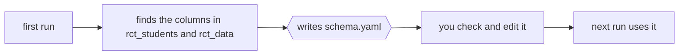

# analyzeRCT

Estimate an RCT's treatment effect, controlling for prior knowledge with models trained on the remnant.

```bash
python analyzeRCT.py <remnant> <order,score,skill/problem,user> <rct_students> <rct_data> [flags]
```

```bash
python analyzeRCT.py data/remnant_2425.csv "id,discrete_score,skill_id/problem_id,user_xid" \
    data/rct_students.csv data/rct_data.csv --BKT --DKT --DKT-P --IRT --Prior5
```

---

## Arguments

| # | Argument | What it is |
| --- | --- | --- |
| 1 | `remnant` | path to problem logs from students **not** in the RCT; the models are trained on these |
| 2 | `order,score,skill/problem,user` | the remnant's column names, in this order |
| 3 | `rct_students` | path to every problem log of the students **in** the RCT |
| 4 | `rct_data` | path to the RCT itself: one row per trial event, with the condition and outcome |

| Flag | Adds |
| --- | --- |
| `--Prior5` | average of the student's last 5 scores (the original control) |
| `--BKT` | Bayesian knowledge tracing |
| `--DKT` | deep knowledge tracing |
| `--DKT-P` | deep knowledge tracing with problem difficulty |
| `--IRT` | item response theory |
| `--schema PATH` | column schema to use (default: `schema.yaml` next to `rct_data`) |
| `--out DIR` | where results go (default: `results/<date-time>`) |

---

## Columns: first run writes a schema, you adjust it



1. **First run.** The remnant's columns come from argument 2. For the other two files the tool finds the
   columns itself (by type, name and which values match across files), writes them to `schema.yaml`, and prints
   what it found.
2. **Adjust.** Anything it got wrong or wasn't sure about, fix in `schema.yaml`. Unsure columns are left blank
   and the run stops until they are filled in.
3. **Every later run** reads `schema.yaml` and skips the guessing.

```yaml
# schema.yaml (written by the first run, edited by hand)
remnant:
  order:   id
  score:   discrete_score
  skill:   skill_id
  problem: problem_id
  user:    user_xid
rct_students:
  order:   pl_id
  score:   discrete_score
  problem: problem_id
  user:    user_xid
rct_data:
  user:      user_xid
  log:       pl_id                      # matches rct_students.order
  problem:   problem_id
  class:     class_id
  treatment: selected_tutor_strategy_ceris != '[]'
  outcome:   next_problem_across
  prior5:    prior_5_across
exclude:
  - user_xid <= 1000                    # internal test accounts
```

---

## Project layout

```
analyzeRCT/
├── analyzeRCT.py        # the command you run
├── analyzerct/          # the code behind it
│   ├── columns.py       #   find columns, read and write schema.yaml
│   ├── load.py          #   read the three files
│   ├── models/          #   one file per flag: prior5, bkt, dkt (DKT + DKT-P), irt
│   ├── predict.py       #   predict each RCT student's next problem from their earlier logs
│   └── effects.py       #   treatment effect and confidence intervals
├── R/                   # optional R versions of the analysis
├── tests/
├── pyproject.toml
└── README.md
```

---

## Setup

```bash
uv sync
```

R (`lme4`, `marginaleffects`, `grf`) is only needed for the optional R analyses.

---

## Outputs

```
results/<date-time>/
├── schema.yaml          # the columns used
├── predictions.csv      # each RCT event with every model's prediction
├── effects.csv          # treatment effect per model, with confidence intervals
├── summary.md           # the report to read
└── models/              # trained models, reused by later runs
```
